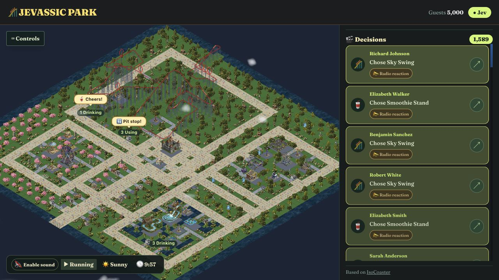

# Jevassic Park

**A living theme park. Jev makes the choices. You watch the chaos.**

[Visit the park →](https://jevassic-park.vercel.app/)



## Inside the park

- **5,000 visitors**, with 100 individually simulated guests making decisions through Jev.
- **One shared park** for every spectator. Spending happens while people watch.
- **Live decisions** with guest names. Follow a choice to follow its guest.
- **Live spectacles:** moving parades, fountain shows and nighttime fireworks. Guests choose whether to join.
- **Auto camera:** smooth highlight shots; pan, zoom or select a guest to take over.
- **Guest stories:** linked ride, recovery and snack moments.
- **Personalities and friends:** six archetypes, matching outfits, shared plans and rare recurring characters.
- **Park rhythm:** lunch rush, afternoon parade, sunset fountains and castle fireworks.
- **Little mishaps:** lost hats, escaping balloons, mascot encounters, photo stops and soaked riders.
- Waving crowds, balloons, cheers and splash reactions. Reduced motion supported.
- Animated rides, water, weather, day and night.
- **Music:** five original fantasy tracks, shuffled, with parade, snack and ride cues.
- A local admin mode for testing crowds, budgets, tempo and broadcasts.

- **Honest counts:** background figures do not make AI calls or inflate service usage.
- **Visitor analytics:** Vercel Web Analytics.

## Run locally

Requires **Node.js 22**.

```sh
npm ci
cp .env.example .env
npm run dev
```

Open [localhost:3000](http://localhost:3000). Localhost has admin controls; deterministic decisions work without credentials.

To use Jev locally, run `vercel link` and `vercel env pull .env.local` for project OIDC, or set a server-only `AI_GATEWAY_API_KEY`.

## Configuration

| Variable | Default | Purpose |
| --- | --- | --- |
| `ADMIN_MODE` | Local: `1`; Vercel: `0` | Enable write controls. Keep public deployments at `0`. |
| `SPECTATOR_POPULATION` | `5000` | Total crowd, from 10 to 10,000. |
| `WATCH_DETAILED_GUESTS` | `100` | Individually simulated guests, from 10 to 1,000. |
| `DECISION_INTERVAL_MS` | `5000` | Minimum gap between decision batches. |
| `WATCH_DAILY_BUDGET` | `5` | Daily Jev ceiling in USD. Set `0` for code decisions. |
| `KV_REST_API_URL`, `KV_REST_API_TOKEN` | — | Shared Redis state, supplied by the integration. |

- Reserve estimated spending before each Jev call.
- Budget exhausted → announcement → deterministic code.
- Reset: **midnight UTC**.
- Gateway guard: **$4.95/day**, below the $5 app ceiling. Gateway caps are soft; the final request may complete.
- Hosting and Redis charges are separate.

## How it works

```text
Visible spectators → Next.js /api/watch → Shared Redis park
                                      → Jev decisions → Validated actions
```

- **Jev:** legal choices, shared park snapshot, individual needs.
- **Code:** movement, paths, needs, queues and rides.
- **Redis:** shared state and atomic request coordination.
- **No audience:** no background AI calls; hidden tabs stop polling.
- **Spectators:** explore and follow. **Admin:** configure and broadcast.
- `ADMIN_MODE` is deployment configuration, not authentication.

## Test

```sh
npm run lint
npm run typecheck
npm test
npm run build
```

Tests mock Jev calls and spend no credits. Coverage includes budgets, concurrency, reachable attractions and a ten-minute simulation for movement, completed rides and decision starvation.

## Deploy to Vercel

1. Import the project into Vercel and use Node.js 22.
2. Connect **Upstash Redis**, using the free plan with automatic paid upgrades disabled.
3. Set `ADMIN_MODE=0`. Use Vercel project OIDC for AI Gateway.
4. Set the Gateway guard, then deploy:

```sh
vercel ai-gateway budgets set project <your-project> --limit 4.95 --refresh-period daily
vercel deploy --prod
```

Keep credentials server-side. The equivalent `UPSTASH_REDIS_REST_URL` and `UPSTASH_REDIS_REST_TOKEN` variables are also supported. Sound defaults on; browsers may require a click before playback.

## Credits

Based on [IsoCoaster](https://github.com/amilich/isometric-city). See [LICENSE](LICENSE) for the MIT license.

Font: [Fraunces · OFL](public/licenses/fraunces-OFL.txt). Music: original.

Regenerate the additional music: `python scripts/compose-music.py` (NumPy + ffmpeg).
